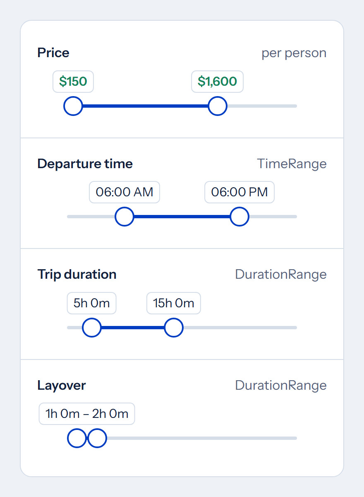

# twin-range

React dual-thumb range slider with floating value labels that auto-merge on overlap.

<picture>
  <source media="(prefers-color-scheme: dark)" srcset="https://raw.githubusercontent.com/devAIDY/twin-range/main/docs/preview-dark.png" />
  
</picture>

To try it yourself, clone the repo and run `npm install && npm run demo`.

- Two thumbs that can't cross, with optional `minDistance`
- Floating labels that combine into one (`$40 – $55`) when they would collide, and split again when they move apart
- Ready-made `TimeRange` (`06:00 AM`) and `DurationRange` (`5h 30m`) sliders
- Optional fixed min/max labels at the ends of the track
- Pointer, touch and keyboard support (arrows, PageUp/PageDown, Home/End). On touch screens, vertical swipes over the slider still scroll the page.
- Accessible: each thumb is a `role="slider"` with live `aria-valuemin`/`aria-valuemax` bounds
- Controlled or uncontrolled, SSR-safe, no dependencies, themable with CSS variables

## Install

```sh
npm install twin-range
# or
yarn add twin-range
# or
pnpm add twin-range
```

Requires React 18 or later.

## Usage

```tsx
import { useState } from "react";
import { TwinRange, type RangeValue } from "twin-range";
import "twin-range/styles.css";

export function PriceFilter() {
  const [price, setPrice] = useState<RangeValue>([200, 800]);

  return (
    <TwinRange
      min={0}
      max={1000}
      step={10}
      value={price}
      onChange={setPrice}
      onChangeEnd={(v) => console.log("committed", v)}
      formatLabel={(v) => `$${v}`}
      ariaLabel={["Minimum price", "Maximum price"]}
    />
  );
}
```

Uncontrolled:

```tsx
<TwinRange defaultValue={[20, 80]} onChangeEnd={save} />
```

## Props

| Prop                | Type                                     | Default                              | Description                                                                           |
| ------------------- | ---------------------------------------- | ------------------------------------ | ------------------------------------------------------------------------------------- |
| `min`               | `number`                                 | `0`                                  | Lowest value.                                                                         |
| `max`               | `number`                                 | `100`                                | Highest value.                                                                        |
| `step`              | `number`                                 | `1`                                  | Value granularity, counted from `min`.                                                |
| `value`             | `[number, number]`                       | none                                 | Controlled value.                                                                     |
| `defaultValue`      | `[number, number]`                       | `[min, max]`                         | Initial value when uncontrolled.                                                      |
| `onChange`          | `(value) => void`                        | none                                 | Called on every change while dragging or on each key press.                           |
| `onChangeEnd`       | `(value) => void`                        | none                                 | Called once per finished interaction: every pointer release (even if the value didn't change), and each key press that changed it. |
| `minDistance`       | `number`                                 | `0`                                  | Smallest allowed gap between the two values.                                          |
| `disabled`          | `boolean`                                | `false`                              | Disables interaction.                                                                 |
| `showLabels`        | `boolean`                                | `true`                               | Render the floating value labels.                                                     |
| `showBounds`        | `boolean`                                | `false`                              | Render fixed `min` and `max` labels at the ends of the track (formatted with `formatLabel`). |
| `formatLabel`       | `(value) => ReactNode`                   | the number                           | Label content. When it returns a string, it's also used as `aria-valuetext`.          |
| `getAriaValueText`  | `(value) => string`                      | the label text                       | What screen readers announce for a value, when it should differ from the label.       |
| `formatMergedLabel` | `(low, high) => ReactNode`               | `` `${low} – ${high}` ``             | Content of the merged label. When both values are equal, a single label is shown.     |
| `mergeGap`          | `number`                                 | `4`                                  | Minimum space in px between the two labels before they merge.                         |
| `ariaLabel`         | `[string, string]`                       | `["Minimum value", "Maximum value"]` | Accessible names for the thumbs.                                                      |
| `id`, `className`, `style` |                                   |                                      | Applied to the root element.                                                          |

## Time and duration sliders

Two ready-made sliders for the most common filters. Both take values in **minutes** and accept every `TwinRange` prop, so any default can be overridden.

### `TimeRange`: time of day

Values are minutes since midnight. Labels read `06:00 AM`.

```tsx
import { TimeRange } from "twin-range";

<TimeRange defaultValue={[360, 1080]} onChangeEnd={([from, to]) => filterDepartures(from, to)} />;
```

Defaults: `min={0}`, `max={1440}`, `step={15}`, thumbs named "Earliest time" and "Latest time".

### `DurationRange`: trip length, layover, and so on

Labels read `5h 30m`, and screen readers hear "5 hours 30 minutes".

```tsx
import { DurationRange } from "twin-range";

<DurationRange min={60} max={1800} defaultValue={[120, 900]} />;    // trip duration
<DurationRange min={30} max={720} step={15} minDistance={15} />;     // layover
```

Defaults: `min={0}`, `max={1440}`, `step={5}`, thumbs named "Minimum duration" and "Maximum duration".

### Formatting helpers

The same formatters are exported for use elsewhere, for example in a summary under the slider:

```ts
import { formatDuration, formatTime } from "twin-range";

formatTime(615);                // "10:15 AM"
formatDuration(330);            // "5h 30m"
formatDuration(45);             // "45m"
formatDuration(330, "long");    // "5 hours 30 minutes"
```

## Styling

Import `twin-range/styles.css` once, then override any of these custom properties on `.twin-range` or your own `className`:

```css
.my-slider {
  --tr-track-height: 4px;
  --tr-track-color: #e0e0e0;
  --tr-fill-color: #003dc2;
  --tr-thumb-size: 24px;
  --tr-thumb-color: #ffffff;
  --tr-thumb-border: 2px solid var(--tr-fill-color);
  --tr-focus-outline: 2px solid #8daee3;
  --tr-label-bg: #ffffff;
  --tr-label-color: #339900;
  --tr-label-border: 1px solid #7d7d7d;
  --tr-label-font-size: 16px;
  --tr-label-padding: 3px 6px;
  --tr-label-radius: 4px;
  --tr-label-offset: 4px;  /* gap between the labels and the top of the thumbs */
  --tr-label-space: 30px;  /* room reserved above the thumbs for the labels */
  --tr-gutter: 40px;       /* side padding, so labels at the ends stay inside the box */
  --tr-transition: 150ms ease;
}
```

For deeper changes, target these elements: `.twin-range`, `.twin-range__rail`, `.twin-range__track`, `.twin-range__fill`, `.twin-range__thumb`, `.twin-range__label` and `.twin-range__bound`. State is exposed through data attributes: `[data-disabled]`, `[data-merged]` on the root, `[data-active]` and `[data-thumb="low|high"]` on thumbs, and `[data-hidden]` on labels.

## How merging works

Both value labels and the merged label are always rendered. After each render, and whenever the slider resizes, the component measures the two value labels. If the right edge of the low label comes within `mergeGap` px of the left edge of the high label, it hides those two labels and shows the merged label centered between the thumbs. Hidden labels use `visibility: hidden`, so they keep their size and can still be measured. This lets the slider split the labels again once they no longer collide.

## Development

```sh
npm install
npm test          # vitest + Testing Library
npm run typecheck
npm run build     # ESM + CJS + .d.ts into dist/
npm run demo      # demo page at http://localhost:5173, reloads as you edit src/
```

## License

MIT
